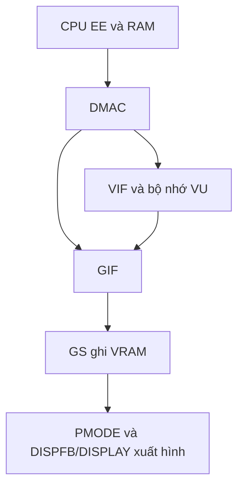

# BIOS PS2 cần những khối nào? — PSLab v36

BIOS khởi động bằng lệnh CPU tại BFC00000. Nó phải khởi tạo bộ nhớ, ngắt,
IOP và giao tiếp giữa các bộ xử lý trước khi toàn bộ giao diện hoạt động.
Thứ tự chi tiết khác nhau giữa các bản BIOS. Một thanh ghi đọc/ghi được
không có nghĩa thiết bị phía sau đã thực thi đầy đủ.

Log(10) đã chạy 638.699 lệnh và in “Initialize memory”, rồi dừng ở
9FC4135C khi SW ghi 0 vào B000F410. Đây là bước khởi tạo bộ nhớ, chưa phải
bằng chứng giao diện BIOS đã dựng xong hay game đã chạy.

## Bản đồ CPU và thiết bị

| Khối | Thanh ghi/vùng quan trọng | Trạng thái hiện tại |
|---|---|---|
| EE CPU/COP0 | Status, Cause, EPC, Count, Compare, Config; Index/EntryHi/EntryLo/PageMask/Wired | Có lệnh và mô hình thanh ghi/TLB; chưa dịch địa chỉ bằng TLB đầy đủ |
| COP1 | f0..f31, FCR0, FCR31 | Có chuyển dữ liệu, load/store, MOV.S, nhánh; chưa tính số thực |
| Bộ nhớ | RAM EE 32 MiB, scratchpad 70000000, BIOS 1FC00000, RAM IOP 1C000000 | Có ánh xạ; không mô phỏng toàn bộ cache và độ trễ |
| MCH | 1000F400..1000F4F0 cách 10h; RICM F430, DRD F440 | v36 có 16 ô backing word, giao thức nhận dạng RDRAM cơ bản; các bit calibration chưa rõ |
| Timer EE | 10000000/10000800/10001000/10001800 | Có count/mode/compare và sự kiện gần đúng |
| Ngắt EE | INTC_STAT 1000F000, INTC_MASK 1000F010; D_STAT 1000E010 | Có xử lý các nguồn đã triển khai |
| DMA0/1 | CHCR/MADR/QWC tại 10008000/10009000 | v36 truyền normal mode đến VIF0/1; chưa chain VIF |
| DMA2 | 1000A000; D_CTRL/D_STAT/D_PCR tại 1000E000..E020 | Có normal/source-chain GIF; MFIFO và stall-control đầy đủ chưa có |
| VIF0/1 | 10003800/10003C00; FIFO 10004000/10005000 | Có 42 vị trí thanh ghi; cấu hình, MPG, UNPACK V4-32 giới hạn |
| VU | 11000000/11004000/11008000/1100C000 | Có bộ nhớ và upload; chưa chạy vi lệnh VU |
| GIF | CTRL/MODE/STAT và TAG tại 10003000; FIFO 10006000 | Có PATH3; chưa PATH1/2 và phân xử đầy đủ |
| GS hiển thị | PMODE, SMODE1/2, DISPFB1/2, DISPLAY1/2, CSR, IMR | Có điều khiển/scanout cơ bản; video timing gần đúng |
| GS vẽ | PRIM, RGBAQ, XYZ, FRAME, SCISSOR, TEST, ALPHA, COLCLAMP, PABE, FBA | v36 mở rộng alpha/test/blend; chưa texture, Z buffer, fog/AA đầy đủ |
| SIF/IOP | 1000F200..F260, RAM IOP, thanh ghi IOP bus/ngắt/DMA | Có cấu hình; chưa CPU IOP, truyền SIF và phản hồi RPC |
| SPU2/CDVD | SPU2 1F900000; CDVD 1F402000 | Chưa triển khai trong nhánh PS2 |

## CPU và GS phối hợp dựng hình

CPU EE tạo gói dữ liệu và ghi thanh ghi khởi chạy DMA. DMA chuyển gói từ RAM
sang VIF hoặc GIF. VIF nạp dữ liệu/mã cho VU; VU xử lý hình học rồi gửi gói
đến GIF khi bộ thực thi VU đã có. GIF giải mã thanh ghi GS. GS raster hóa vào
VRAM; mạch hiển thị lấy vùng được DISPFB/DISPLAY chọn để xuất màn hình.

Trong PSLab, GS hiện vẽ bằng phần mềm C++. VU chưa thực thi nên nhánh
VIF → VU → GIF chưa hoàn chỉnh. Các demo do dự án tự viết kiểm tra những
đường đã có; không dùng kết quả demo để kết luận BIOS Sony/game tương thích.

## v36 thực sự bổ sung gì?

- Vá SW tại B000F410; mở khối 16 ô MCH word với log/số lần truy cập/reset.
  Đây là mô hình backing theo cách tham khảo PCSX2. Chỉ RICM/DRD có giao thức
  cơ bản; các ô chưa rõ không được đặt tên/tác dụng phần cứng giả định.
- Normal DMA0/1 truyền dữ liệu thật đến VIF, cập nhật MADR/QWC và D_STAT;
  tôn trọng gate DMA và stall VIF. Không đánh dấu xong nếu parser chưa nhận gói.
- VIF thêm BASE/OFFSET/ITOP, MPG và UNPACK V4-32 khi MODE=0, CL=WL,
  không masking/skip/fill. Gói lỗi không ghi dở bộ nhớ VU.
- GS thêm 8 phép thử alpha, 4 chế độ xử lý khi fail (với Z writes tắt),
  destination-alpha test, công thức blend ALPHA, COLCLAMP và PABE.
  Chưa có depth comparison/Z writes; không tuyên bố raster chính xác từng bit.

## Kiểm tra trên máy bạn

Giải nén vào thư mục mới, build Release x64, mở pslab.exe và kiểm tra tiêu đề
v36. Nạp BIOS (test), chọn Run continuously. Nếu dừng, Save log để lấy cả PC,
opcode, trạng thái MCH/DMA/VIF/GS. Không cần bấm Run 100k liên tục.

Chưa thể bảo đảm “vá hết BIOS PS2” chỉ bằng bản cập nhật này: CPU IOP,
SIF/DMA hai phía, VU, nhiều phần cache/TLB, FPU arithmetic và thiết bị vẫn thiếu.

## Nguồn tra cứu

ps2tek: bản đồ I/O, DMA, VIF, GS và SIF:
https://psi-rockin.github.io/ps2tek/index.html
PCSX2 HwRead/HwWrite: chính sách F410/RICM và backing memory controller:
https://sources.debian.org/src/pcsx2/1.6.0%2Bdfsg-2/pcsx2/HwRead.cpp
https://sources.debian.org/src/pcsx2/1.6.0%2Bdfsg-2/pcsx2/HwWrite.cpp
PCSX2 Hw.h: phạm vi MCH F400..F500:
https://raw.githubusercontent.com/PCSX2/pcsx2/master/pcsx2/Hw.h
EE Core User's Manual: CPU/COP0/COP1:
https://docs.alexrp.com/mips/ee.pdf
Mã mới do dự án viết; không sao chép core bên ngoài hoặc đóng gói BIOS Sony.
